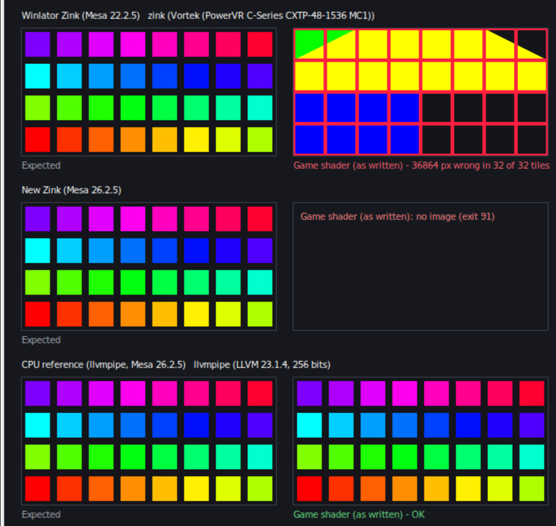
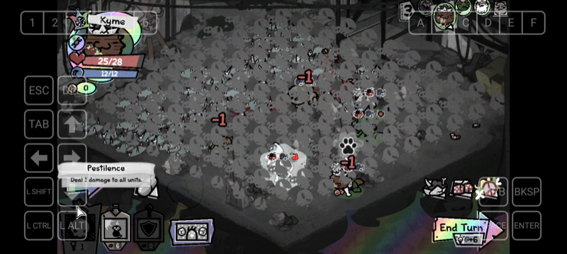
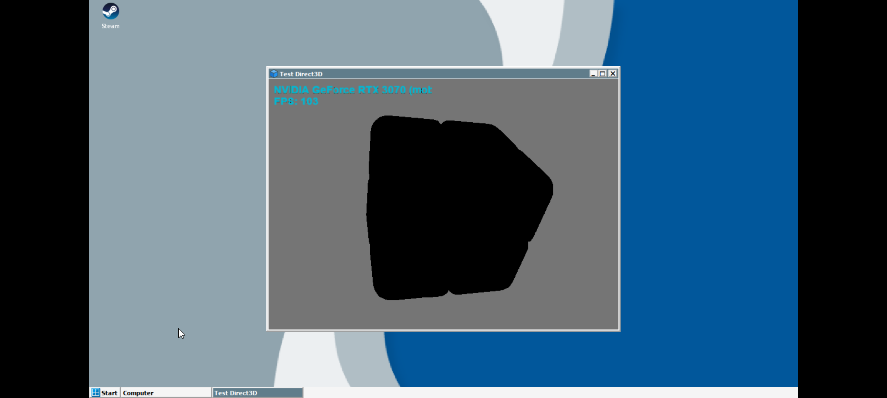

# Winlator on a PowerVR phone: a GPU debugging case study

Getting two PC games, **Mewgenics** (OpenGL) and **Slay the Spire 2** (Direct3D 12), to render
on the GPU of a Pixel 11 Pro XL through [Winlator](https://github.com/brunodev85/winlator), an
Android app that runs Windows games with Wine and Box64. The Pixel's Tensor G5 moved to an
Imagination **PowerVR** GPU, which the Winlator graphics stack had never been tuned for.

This repo is the write-up, not the code. My fork has about 60 commits on top of upstream
Winlator. The fixes stay private until I have reviewed them and sent them upstream myself, so
this page describes the method and the outcomes, not the bugs.

Developed with AI-assisted tooling; the investigation, decisions and review are mine.

## The chain

```text
game ─ OpenGL ──> Wine + Box64 ──> Mesa Zink (GL on Vulkan) ──┐
game ─ D3D12  ──> vkd3d-proton ──> winevulkan ─────────────────┤
                                                                v
          Vortek (Vulkan client in the container ──> server in the Android app)
                                                                v
                                                   PowerVR Vulkan driver
```

Every layer is a suspect.

## Method

- **Every claim cites evidence**: a log line, a screenshot, a file and line, a command's output.
  A ledger holds the facts, the derivations built on them, the open hypotheses, and the tests.
  About 200 facts and 90 tests so far.
- **The prediction is written before each test**, both branches: what we'd see if the
  hypothesis is true, and what we'd see if it's false.
- **One variable per test.** Each phone test is a numbered APK that differs from the one before
  in exactly one change. Logging-only builds exist to answer a single question.
- **Isolate on the Mac first.** A Podman container with the same Mesa version reproduces shader
  output off the phone; a software renderer on the phone separates "the game is broken" from
  "the GPU path is broken".
- **Build tools when the question needs one.** `diffgl3` (below) draws a game's real shader
  through several drivers side by side and boxes every wrong pixel, so "does it look right"
  becomes a number.

## Mewgenics: from garbage to playable

The game drew flashing flat-colour shapes while its music played, so the game itself was fine.
A software renderer on the CPU drew it correctly at ~1 fps: the fault was in the GPU path.



*`diffgl3` on the Pixel: the game's shader as written (right) against the expected image (left).
Top row: the shipped GPU path, 36,864 wrong pixels in 32 of 32 tiles. Bottom row: the CPU
reference, correct.*

Three hypotheses went into the ledger. Two were refuted (one by reading the source, one on the
phone after it fixed the Mac output but not the Pixel). The third held. Fixing it exposed a
second, unrelated failure (a black screen), which took one more build. Four phone builds from
the first patch (one of them an unpatched control) to:



*Mewgenics in combat, rendered on the Pixel's GPU.*

## Slay the Spire 2: one wall per build

StS2 failed in a new way each time the previous failure was fixed: memory, runtime start-up,
texture creation, a crash, a black window, a crash, a lost device. **Fourteen phone builds in one
day**, many of them logging-only, each answering one question. The menu rendered on the ninth,
and the game is playable on its Vulkan path. Its default D3D12 path and one device-lost are still
open, and Winlator's own Test Direct3D shares the D3D12 failure:



*Test Direct3D running at ~100 fps on the GPU with the object drawn black. Open.*

## Built along the way

- **FPS counter and frame log** in the app, with 77 unit tests and a mutation gate (faults
  injected into the code to prove the tests catch them).
- **Probe suite**: small Windows programs that each check one property of the graphics stack,
  with a Mac gate that runs them on a software Vulkan driver in Podman before anything reaches the
  phone.
- **DualSense pass-through**: the controller reaches Wine as itself instead of as a generic
  gamepad. Built and gated on the Mac; the phone test is next.
- Input and stability fixes found by playing, queued for upstream.

## Where it stands (November 2026)

- Mewgenics: renders and plays on the GPU. 60 fps not yet verified; it needs a new frame source
  for the FPS counter first.
- Slay the Spire 2: menu and gameplay on the Vulkan path, but fps is low and stuttery; D3D12 and
  one device-lost are open.
- Test Direct3D: runs, object black.

[TIMELINE.md](TIMELINE.md) shows the pace, day by day.

## Acknowledgements

Thanks to [BrunoDev](https://github.com/brunodev85) for creating
[Winlator](https://github.com/brunodev85/winlator), maintaining it, and releasing it as open
source. None of this work would exist without it. Thanks also to the Wine, Box64, Mesa and
vkd3d-proton projects it builds on.

## License

All rights reserved. Published for review only.
